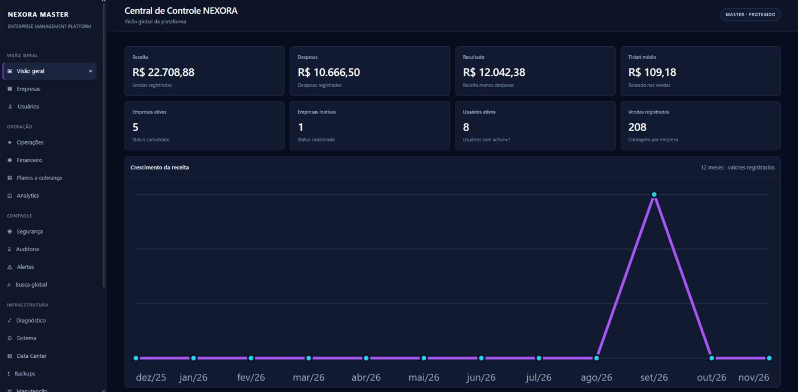
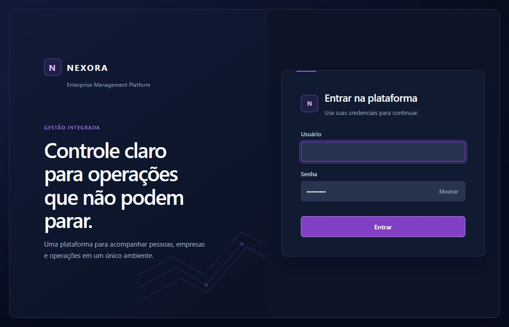

# 🧾 NEXORA Gestão: Sistema de Gestão Multiempresa (PDV, Estoque, Caixa e Restaurante)

[](https://github.com/GustavoPires275/nexora-gestao/actions/workflows/testes.yml)

Sistema de gestão completo para pequenos negócios, em produção e usado por lojas e restaurantes. Uma única instalação atende várias empresas, cada uma com seus dados isolados, e um painel master controla toda a plataforma.

<p align="center"></p>
<p align="center"></p>

> Este repositório traz o código-fonte sem nenhum banco de dados ou dado de cliente. O banco é criado do zero na primeira execução.

## O problema

Pequenos comércios controlavam estoque de cabeça, fechavam o caixa na calculadora e não sabiam quanto lucravam no mês.

## Funcionalidades

**Operação da loja**
- **PDV (frente de caixa):** venda com desconto, várias formas de pagamento e baixa automática no estoque
- **Caixa:** abertura, fechamento, sangria e suprimento, com conferência por forma de pagamento
- **Estoque:** produtos com SKU e código de barras, estoque mínimo e histórico completo de movimentações
- **Compras e fornecedores**, com entrada de mercadoria no estoque
- **Clientes, despesas e relatórios**, com ticket médio no dashboard e exportação de dados
- **Perfis de acesso:** admin, gerente, vendedor e caixa, cada um com permissões próprias

**Módulo restaurante**
- Mesas e comandas, com transferência, fechamento e pagamento
- **QR Code na mesa:** o cliente chama o garçom ou pede a conta pelo celular
- Fila de pedidos com status para cozinha e atendimento
- **Atualização em tempo real via WebSocket**

**Plataforma (painel master)**
- **Multi-tenant:** várias empresas na mesma instalação, com isolamento por `company_id`
- Planos, limites de uso por empresa e feature flags
- Modo manutenção, avisos para todas as empresas e sessões de suporte
- Backups do banco, log de auditoria e eventos de segurança

**Segurança**
- Senhas com PBKDF2 e salt, sessões com expiração e limite de tentativas de login
- Nenhuma senha padrão: o primeiro administrador é criado pela variável de ambiente `LOJA_INITIAL_ADMIN_PASSWORD`
- Trilha de auditoria de todas as ações

## Stack

`Python` · `FastAPI` · `Uvicorn` · `SQLite` · `WebSockets` · `HTML/CSS/JavaScript` · `Render`

## Rodar localmente

```bash
git clone https://github.com/GustavoPires275/nexora-gestao.git
cd nexora-gestao
pip install -r requirements.txt
export LOJA_INITIAL_ADMIN_PASSWORD="uma-senha-forte-aqui"   # mínimo de 12 caracteres
uvicorn app:app --reload
```

Depois, acesse `http://127.0.0.1:8000` e entre com o usuário `admin` e a senha que você definiu. Na primeira execução, o sistema cria a empresa e o administrador.

## Testes

```bash
pip install pytest httpx
pytest -q tests
```

Os testes sobem o sistema com um banco novo e cobrem login, sessão, permissões, cadastro de produto, abertura de caixa e venda com baixa de estoque. Eles rodam no GitHub Actions a cada push.

---

Desenvolvido por **Gustavo Pires**: sites, sistemas e automações para negócios reais.
